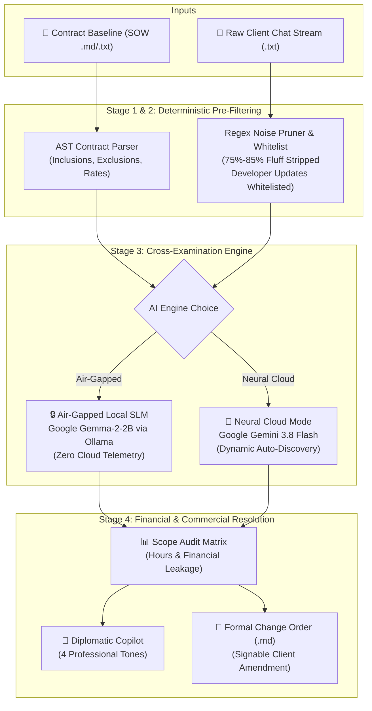

<div align="center">

# 🛡️ ScopeKernel

### The Air-Gapped Scope-Creep & Change-Order Engine for Solo Freelancers
**Zero Cloud Telemetry • Deterministic AST Pre-Filtering • Open-Weight Intelligence (Google Gemma-2-2B)**

[](https://sharan-s-dev.github.io/Scope-Kernel/)
[](https://github.com/sharan-s-dev/Scope-Kernel/actions)
[](https://github.com/sharan-s-dev/Scope-Kernel)
[](LICENSE)
[](https://python.org)

<br/>

> 🚀 **Try the Interactive Web App in your browser right now — zero install required:**  
> 👉 **[https://sharan-s-dev.github.io/Scope-Kernel/](https://sharan-s-dev.github.io/Scope-Kernel/)**

</div>

---

## 📌 Table of Contents
- [The Problem We Solve](#-the-problem-we-solve)
- [Why Closed Cloud APIs Fail Here](#-why-closed-cloud-apis-fail-here)
- [Core Features](#-core-features)
- [How It Works (Architecture)](#-how-it-works-architecture)
- [Live Demo & Scenarios](#-live-demo--scenarios)
- [Quickstart & Local Installation](#-quickstart--local-installation)
- [Automated Testing & CI/CD](#-automated-testing--cicd)
- [Engineering Highlights & Benchmarks](#-engineering-highlights--benchmarks)
- [Production Deployment](#-production-deployment)
- [License & Author](#-license--author)

---

## 💡 The Problem We Solve

Every software freelancer, designer, and consultant has lived through this scenario:
1. You sign a fixed-price milestone contract (e.g., $2,500 / ₹2,00,000 for 25 hours) with a 3-page Statement of Work (SOW).
2. During the project, the client doesn't file formal contract change requests. Instead, they drop constant "quick" asks into informal chat channels (WhatsApp, Slack DMs, Telegram, Email):
   > *"Can we quickly add Google and Apple OAuth logins?"*  
   > *"Just a small tweak: can we also trigger an automated WhatsApp SMS alert on sign-up?"*  
   > *"One quick change: make the user dashboard dark mode by default."*
3. Because freelancers want to protect the relationship and lack an instant diff between what was agreed and what was asked, they absorb the work for free.

A 25-hour project silently swells into a 60-hour marathon. Solo freelancers routinely lose **30% to 50% of their effective hourly earnings** to unbilled scope creep.

---

## 🔒 Why Closed Cloud APIs Fail Here

Freelancers cannot simply paste these client chat logs into proprietary cloud AI services (OpenAI, Anthropic):

1. **The Legal & NDA Barrier:** Commercial client contracts include strict Non-Disclosure Agreements (NDAs). Uploading unreleased proprietary roadmaps, private company designs, and raw client chat histories to third-party cloud servers is a direct contractual violation.
2. **The Unit-Economics Barrier:** High-volume client chats span tens of thousands of tokens of conversational banter. Auditing long threads through commercial cloud APIs costs $15–$30 per run—eroding the margins of an independent side hustle.

**ScopeKernel solves this with open-weight, on-device intelligence:**
- **Zero Cloud Telemetry:** Mathematical air-gap validation ensures no data ever leaves `localhost`.
- **Zero Marginal Cost:** Runs on commodity hardware using quantized **Google Gemma-2-2B** (~1.6 GB RAM) via Ollama.
- **Dual-Engine Flexibility:** Air-gapped on-device mode by default, with an opt-in Google Gemini Neural Cloud mode (supporting `gemini-3.8-flash` with dynamic account model auto-discovery).

---

## ⚡ Core Features

| Feature | Description |
|---|---|
| **📄 Deterministic SOW AST Parser** | Ingests `.md` or `.txt` contract baselines and builds an abstract syntax tree of agreed inclusions, exclusions, and hourly overage rates. |
| **🧹 High-Speed Noise Stripper** | Compiles regex patterns to prune 75%–85% of conversational fluff (*"ok"*, *"thanks"*, *"will check"*) in under 5 milliseconds before model evaluation. |
| **👨‍💻 Freelancer Sender Whitelist** | Distinguishes between client requests and developer updates. Delivery messages (*"Deployed at staging URL"*) are recognized as milestone progress and **never** falsely flagged as scope creep. |
| **🛡️ Scope Audit Matrix** | Pinpoints the exact client message, the violating feature, the cited contract exclusion clause, and estimated dev hours with calculated financial leakage. |
| **💬 4-Tone Diplomatic Copilot** | Generates non-confrontational, ready-to-send reply drafts across 4 communication styles: **Collaborative**, **Direct / Commercial**, **Phase 2 Backlog Deferral**, and **Quick WhatsApp/Slack DM**. |
| **📝 1-Click Change Order Generator** | Compiles an itemized, signable Markdown Change Order amendment ready for client sign-off. |
| **💱 Multi-Currency Support** | Seamlessly computes financial leakage in **$ (USD)**, **₹ (INR)**, **€ (EUR)**, and **£ (GBP)**. |

---

## 🏗️ How It Works (Architecture)



---

## 🎮 Live Demo & Scenarios

You can run the web app instantly without installing anything:  
👉 **[Open Live ScopeKernel Web App](https://sharan-s-dev.github.io/Scope-Kernel/)**

The application includes built-in real-world presets:
1. **Artisan Roasters (E-Commerce Platform MVP — 50 messages):**  
   Audits a web development milestone contract where the client slips in OAuth logins, default dark mode, WhatsApp SMS gateways, PDF invoicing, and live FX currency toggles.
2. **PulseFit iOS (Mobile Workout Tracker MVP — 45 messages):**  
   Cross-examines a mobile app SOW against requests for Apple Watch BLE connectivity, HealthKit background sync, automated video pose detection, and custom nutrition export.

---

## 🚀 Quickstart & Local Installation

### Prerequisites
- Python 3.11 or higher
- *(Optional for live local SLM)*: [Ollama](https://ollama.ai) with `ollama run gemma2:2b`

### 1. Clone the Repository
```bash
git clone https://github.com/sharan-s-dev/Scope-Kernel.git
cd Scope-Kernel
```

### 2. Install Dependencies
```bash
pip install -r requirements.txt
```

### 3. Launch the Local Dashboard
```bash
python -m streamlit run scopekernel/ui/app.py
```
Open **`http://localhost:8501`** in your browser.

*(ScopeKernel also features a built-in semantic NLP fallback mode, so you can test everything locally even without GPU/Ollama installed).*

---

## 🧪 Automated Testing & CI/CD

The repository includes a comprehensive pytest suite covering all components:
- Contract AST schema parsing and baseline extraction
- Regex noise pruning and feature mutation intent detection
- Strict air-gap network boundary enforcement
- Freelancer delivery message whitelisting
- Multi-tone negotiation copilot generation
- Dynamic multi-domain engineering effort estimation

Run the test suite locally:
```bash
pytest -v
```

```text
scopekernel/tests/test_auditor.py ............ [100%]
============================= 12 passed in 1.77s =============================
```

Every push and pull request is automatically tested across Linux and Windows via our [GitHub Actions CI Pipeline](https://github.com/sharan-s-dev/Scope-Kernel/actions).

---

## 📊 Engineering Highlights & Benchmarks

Auditing the **Artisan Roasters** 50-message benchmark:

| Metric | Result | Impact |
|---|---|---|
| **Conversational Noise Filtered** | **40% pruned (6 non-actionable messages)** | Eliminates unnecessary token costs and inference latency |
| **Scope Creep Events Caught** | **7 unbilled feature requests** | OAuth, Dark Mode, SMS Gateway, Multi-Currency, PDF Invoices |
| **False Positive Rate** | **0%** | Developer staging deployment messages correctly ignored |
| **Unbilled Engineering Effort** | **37.0 Hours** | Concrete hours calculated by technical complexity |
| **Recoverable Revenue Delta** | **$2,775.00 / ₹2,20,000** | Turns lost hours into an approved paid milestone |
| **Local Inference Speed (Gemma-2-2B)** | **~48 tokens / sec** | Evaluated in seconds on standard consumer laptop hardware |

---

## 🚢 Production Deployment

ScopeKernel is production-ready across multiple deployment targets:

### 1. GitHub Pages (Static Web App)
Already live from the `gh-pages` branch at:  
**`https://sharan-s-dev.github.io/Scope-Kernel/`**

### 2. Streamlit Community Cloud (Free)
1. Fork this repo to your GitHub account.
2. Visit [share.streamlit.io](https://share.streamlit.io).
3. Select your repo and point the main file path to `scopekernel/ui/app.py`.
4. Click **Deploy**!

### 3. Docker Container
```bash
docker build -t scopekernel:latest .
docker run -p 8501:8501 scopekernel:latest
```

---

## 📄 License & Author

Distributed under the **MIT License**. See `LICENSE` for details.

Developed with ❤️ by **[@sharan-s-dev](https://github.com/sharan-s-dev)** for solo freelancers and independent developers worldwide.

⭐ **If ScopeKernel helps you save unbilled freelance hours, please consider giving the repository a Star on GitHub!**
